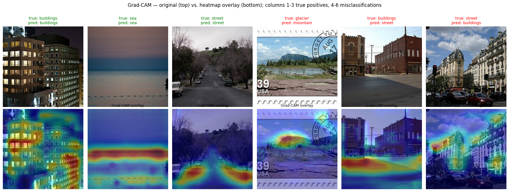
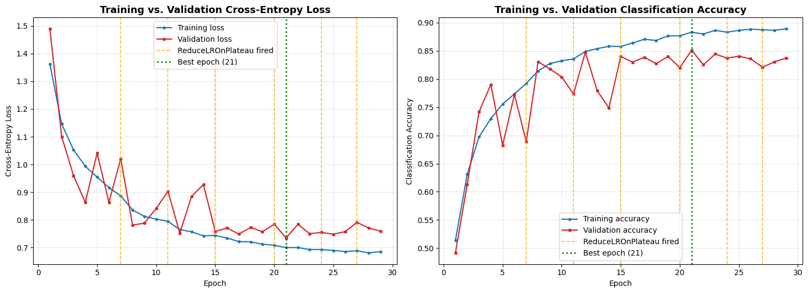
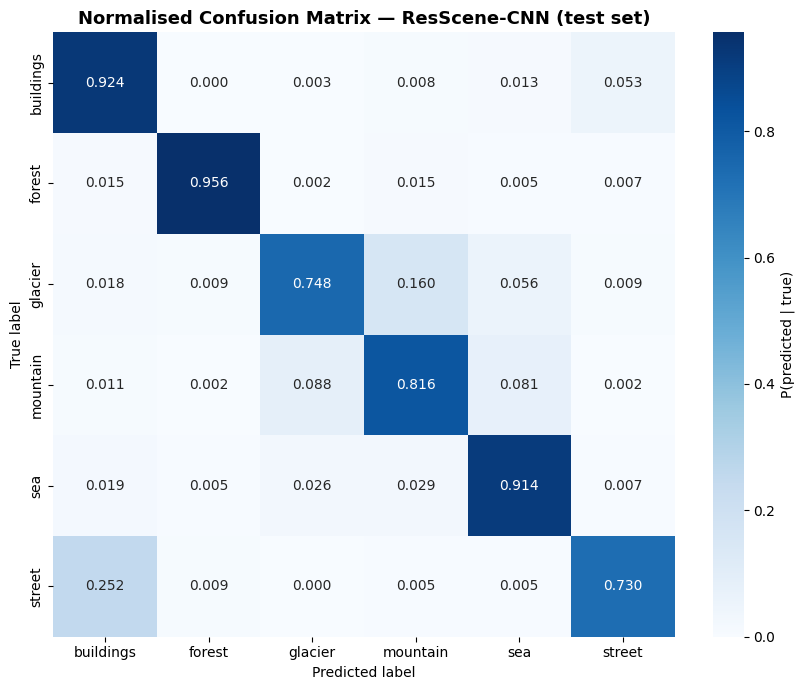

<div align="center">

# ResScene-CNN v2

**A squeeze-and-excitation residual CNN for scene classification, explained with Grad-CAM written from scratch**

[](https://www.tensorflow.org)
[](https://keras.io)
[](#results)
[](#architecture)
[](https://github.com/Mazen-devs/resscene-cnn-gradcam/actions/workflows/tests.yml)
[](LICENSE)



*Grad-CAM showed that one of the model's "mistakes" is a postage stamp labelled "glacier". The model called it a mountain and pointed at the mountain.*

</div>

---

## TL;DR

| | |
|---|---|
| **Task** | 6-class natural scene classification (buildings, forest, glacier, mountain, sea, street) on **17,034** Intel Image Classification images at 150×150 |
| **Model** | 4 residual blocks with **squeeze-and-excitation** channel attention, Keras Functional API, **1,309,794 parameters** |
| **Result** | **84.47% test accuracy, macro F1 0.8455** (84.74% with flip test-time augmentation) |
| **Interpretability** | Grad-CAM implemented from scratch with `tf.GradientTape` (no explanation library) |
| **Benchmark** | A fine-tuned ImageNet EfficientNetB0 (4.06M params) scores higher overall (90.10%), but my 3.1× smaller model has **better glacier recall (0.748 vs 0.689)** |


## Pipeline engineering

- **Leakage-free split.** The official train and test folders were pooled and re-split **70/15/15, stratified, seed 42** (11,923 / 2,555 / 2,556). Assertions check that the three splits are disjoint and exhaustive; class proportions match the full dataset to within **0.03 percentage points**.
- **`tf.data` pipeline** with caching and prefetching, so the GPU is not starved by Python-side image decoding.
- **Train-only augmentation:** horizontal flip, rotation, zoom, translation and contrast jitter.
- **Parameter count checked by hand.** The notebook recomputes the parameters of every layer type from first principles and compares them with `model.summary()`.

## Architecture

```
input 150×150×3
 ├─ ResBlock(32)                        each ResBlock:
 ├─ ResBlock(64)                          Conv3×3-BN-ReLU-Conv3×3-BN
 ├─ ResBlock(128) + SpatialDropout 0.3    → squeeze-and-excitation (r = 8)
 ├─ ResBlock(256) + SpatialDropout 0.3    + identity or 1×1 projection skip
 │      └─ "gradcam_target" layer         → ReLU → MaxPool
 └─ GlobalAvgPool → Dense 256 → Dropout 0.5 → Softmax(6)
```

**Why squeeze-and-excitation?** Scene classes share low-level textures (snow, rock, sky, brick). SE blocks learn a per-channel weight from global context, letting the network up-weight the channels that separate, for example, glacier ice from mountain rock. The 4 SE modules cost about **22K parameters (+1.7%)**.

**Why residual skips?** They keep gradients flowing through the 8 convolutional layers and let each block learn a correction rather than a full transformation.

Source: [`src/model.py`](src/model.py) (verbatim from the notebook, plus a reusable `grad_cam()` function). Tests: [`tests/test_model.py`](tests/test_model.py).

## Training

AdamW (lr 1e-3, weight decay 1e-4) · categorical cross-entropy with label smoothing 0.1 · batch 32 · EarlyStopping (patience 8, restore best) · ReduceLROnPlateau (×0.5, patience 3) · ModelCheckpoint · Tesla T4.

Training stopped at epoch 29 and restored epoch 21. The learning rate was halved six times (epochs 7, 11, 15, 20, 24, 27). At the restored epoch the train-validation loss gap is 0.035 and the accuracy gap 3.2 points: a mild, controlled generalisation gap.



## Results

| Model | Params | Test accuracy | Macro F1 |
|---|---|---|---|
| **ResScene-CNN v2 (this work)** | 1,309,794 | **84.47%** | **0.8455** |
| ResScene-CNN v2 + flip TTA | 1,309,794 | 84.74% | 0.8484 |
| EfficientNetB0, ImageNet pretrained, fine-tuned (benchmark) | 4,057,257 | 90.10% | 0.9009 |

| Recall per class | buildings | forest | glacier | mountain | sea | street |
|---|---|---|---|---|---|---|
| ResScene-CNN v2 | 0.924 | 0.956 | **0.748** | 0.816 | 0.914 | 0.730 |
| EfficientNetB0 | 0.934 | 0.976 | 0.689 | 0.939 | 0.966 | 0.915 |

The pretrained model is better on five of six classes, as expected from ImageNet features. The custom model wins on **glacier**, the class most entangled with mountain.



### Where the errors come from

Two class pairs cause **241 of the 397 test errors (60.7%)**:

- **buildings ↔ street: 130 mutual errors.** 25.2% of street images are predicted as buildings. The classes co-occur in the real world (streets are lined with buildings), so the label is a judgement about the *dominant* subject.
- **glacier ↔ mountain: 111 mutual errors.** 16.0% of glacier images are predicted as mountain. Glaciers sit on mountains, and both share snow, rock and sky.

### What Grad-CAM revealed

| Image | Prediction | Where the model looked |
|---|---|---|
| buildings | buildings ✅ | lit window grid and façade edges |
| sea | sea ✅ | a horizontal band at the **horizon**: right answer, but a single compositional cue |
| street | street ✅ | roadside edges and parked cars |
| glacier | mountain ❌ | the image is a **postage stamp** of a mountain lake; the model looked at the mountain |
| buildings | street ❌ | the road surface in the foreground |
| street | buildings ❌ | ornate façades filling the frame |

The errors are not random: when shared context (road, façade, mountain) fills most of the frame, the network weights that context. The stamp also shows the **test set itself contains out-of-distribution or mislabelled images**, which caps the accuracy any model can honestly reach.

## About the two runs

This repository contains the executed notebook from one training run (**84.47%**). An earlier run of the same code, used in my written report, reached **85.68%** (EfficientNetB0 90.96%). Seeds were fixed, but GPU kernels are not fully deterministic, so runs differ by about a point. Reporting both is more honest than picking the better one; reporting a mean over several seeds is on the to-do list.

## What I learned

- Interpretability is a debugging tool, not decoration: Grad-CAM found a data-quality problem that accuracy alone would have hidden.
- Comparing against a strong pretrained baseline keeps claims honest. My model is smaller, not better overall.
- Single-run results are fragile; seeds alone do not guarantee GPU determinism.

## Next steps

- [ ] Audit the test set for mislabelled or out-of-distribution images (like the stamp) and report accuracy with and without them
- [ ] Repeat training over 5 seeds and report mean ± standard deviation
- [ ] Try a pretrained backbone with SE-style attention to combine both strengths

## Run it

```bash
git clone https://github.com/Mazen-devs/resscene-cnn-gradcam.git
cd resscene-cnn-gradcam
pip install -r requirements.txt
python src/model.py      # builds the model and prints the parameter count
pytest -q                # architecture and Grad-CAM tests (CPU)
```

Full training: open [`notebooks/resscene_cnn_v2.ipynb`](notebooks/resscene_cnn_v2.ipynb) in Google Colab with a GPU. The dataset is the [Intel Image Classification dataset on Kaggle](https://www.kaggle.com/datasets/puneet6060/intel-image-classification), loaded through `kagglehub`.

```python
from model import build_resscene_cnn, grad_cam
model = build_resscene_cnn()
heatmap = grad_cam(model, image_float01, class_index=2)   # (H', W') in [0, 1]
```

## References

He et al., *Deep Residual Learning* (2016) · Hu et al., *Squeeze-and-Excitation Networks* (2018) · Selvaraju et al., *Grad-CAM* (2017) · Tan & Le, *EfficientNet* (2019) · Loshchilov & Hutter, *Decoupled Weight Decay (AdamW)* (2019)

---

<sub>Built by Mazen Mehna as part of a BSc Computer Science (AI) at Taylor's University. MIT licensed. Dataset © its Kaggle authors.</sub>
